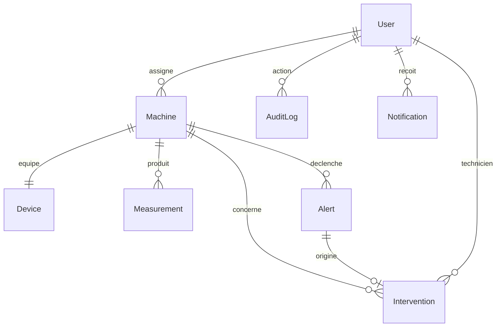

# Modèle de données

## Collections

- **User** : email unique, `passwordHash` (select:false), rôle `admin` | `maintenance_manager` | `technician`.
- **Machine** : code unique, seuils, `healthStatus`, `operationalStatus`, `deviceId`, technicien.
- **Device** : `hardwareId`, `secretHash`, `revoked`, `lastSeenAt`. Identifiants distincts des comptes utilisateurs.
- **Measurement** : collection dédiée (pas embarquée dans Machine). Index `{ machineId, measuredAt }`.
- **Alert** : `fingerprint` pour déduplication, statuts `new` → `acknowledged` → `in_progress` → `resolved`.
- **Intervention** : transitions de statut validées côté serveur.
- **AuditLog** : actions sensibles (sans mot de passe ni jeton).
- **Notification** : notifications in-app (pas de fournisseur push intégré).
- **HealthStateLog** : historique des états pour la disponibilité.
- **SystemSettings** : rétention, délai hors ligne.

Les mesures de démonstration portent `source: "simulation"`.
