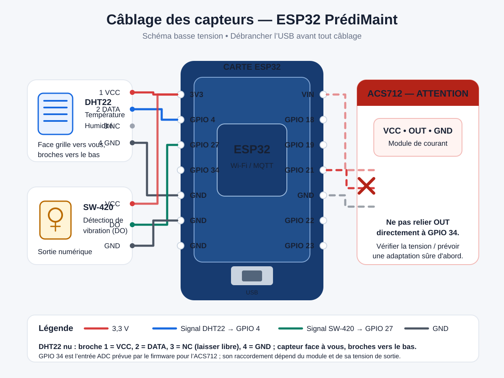

# Câblage ESP32 et capteurs

La compilation confirme le code, mais aucun test physique ni calibration des capteurs n'a été réalisé. Les broches ci-dessous sont des **choix par défaut**, à adapter au montage.

## Schéma de câblage



## Matériel


| Élément | Rôle | Notes |
| --- | --- | --- |
| ESP32 NodeMCU | Wi-Fi + MQTT | Logique 3,3 V |
| DHT22 / AM2302 | Température et humidité | Une résistance pull-up DATA de 4,7–10 kΩ vers 3,3 V peut être nécessaire si elle n'est pas déjà présente sur le module |
| ACS712 | Courant | Sensibilité selon le module (5 A ≈ 185 mV/A, 20 A ≈ 100 mV/A, 30 A ≈ 66 mV/A) |
| SW-420 | Détection de vibration | Sortie numérique DO ; détection événementielle, ne mesure pas une accélération en g |


## Broches par défaut (`iot/firmware/src/main.cpp`)


| Signal | GPIO |
| --- | --- |
| DHT22 DATA | 4 |
| ACS712 OUT | 34 (ADC1) |
| SW-420 DO | 27 |

### DHT22 nu à 4 broches (comme sur la photo)

Tiens le capteur avec **la grille face à toi et les broches vers le bas**. De
gauche à droite, le brochage standard est :

1. **VCC** → ESP32 **3V3**
2. **DATA** → ESP32 **GPIO 4**
3. **NC** → ne rien brancher
4. **GND** → ESP32 **GND**

Pour un capteur nu, ajoute une résistance pull-up de **4,7 à 10 kΩ entre VCC
et DATA**. Ne te fie pas aux couleurs des fils ; si ton capteur est monté sur
une carte/module ou si son orientation diffère, vérifie les repères de cette
carte avant de l'alimenter.

Le schéma ci-dessus montre ces quatre broches et l'orientation de lecture.


Alimenter les capteurs selon leur notice. L'ADC ESP32 ne tolère pas plus de 3,3 V : certains modules ACS712 alimentés en 5 V peuvent nécessiter une adaptation de tension. Vérifier également que la sortie DO du SW-420 ne dépasse pas 3,3 V.

## Calibration

Dans le firmware :

- `SENSITIVITY_V_PER_A` : sensibilité ACS712.
- `VREF_MID` : tension mesurée sur GPIO 34 à courant nul, après toute adaptation de tension.
- `SW420_ACTIVE_LEVEL` : niveau logique actif du SW-420. Le code suppose `LOW`; certains modules peuvent nécessiter `HIGH`.

Avant de brancher l'ACS712 à l'ESP32, vérifier au multimètre la tension de sa sortie OUT au repos et celle qui arrive à GPIO 34. La sortie d'un module alimenté en 5 V peut dépasser la limite de 3,3 V de l'ESP32 : utiliser une adaptation appropriée, puis calibrer `VREF_MID` et la sensibilité effective correspondante. À courant nul, la mesure doit être proche de 0 A. Une valeur fortement négative peut indiquer une référence ou un câblage incorrect ; ne pas corriger cela en changeant la constante au hasard.

Sans calibration, les ampères restent des **approximations**. Le SW-420 fournit seulement un indicateur binaire de vibration détectée pendant l'intervalle d'échantillonnage, pas une mesure de sévérité.

### Seuils d'alerte pour un essai

Dans l'interface web, ouvrir **Seuils & système**, choisir la machine ESP32,
puis renseigner les valeurs d'avertissement et critiques. Pour vérifier le
déclenchement avec les mesures observées sur ESP32-004 (environ 24,5 °C,
vibration 0/1 et courant actuellement hors plage), les valeurs **de démonstration
uniquement** peuvent être :

| Paramètre | Warning | Critique | Remarque |
| --- | ---: | ---: | --- |
| Température | 24 °C | 30 °C | Déclenche un warning au-dessus de 24 °C ; ce ne sont pas des seuils de production validés. |
| SW-420 | 0,5 | 2 | `1` déclenche un warning ; le SW-420 ne fournit pas de niveau critique ni une mesure en g. |
| Courant | 8 A | 12 A | Ne pas interpréter les valeurs avant calibration de l'ACS712. |
| Échantillons avant alerte | 1 | — | Pour le test immédiat. À 4 s par échantillon, le réglage courant de 3 demande environ 12 s. |

Ces seuils s'appliquent à la machine choisie. Pour la production, les définir
selon les spécifications de la machine et des capteurs, et non à partir de ces
valeurs de démonstration.

## Compilation

```bash
cd iot/firmware
copy secrets.example.h secrets.h
```

Renseigner Wi-Fi, IP du broker, `DEVICE_ID` (ex. `ESP32-001`) identique à l’appareil créé dans PrédiMaint.

Dans `iot/firmware/src/main.cpp`, `SIMULATION_MODE` vaut maintenant `0` pour lire les capteurs physiques. Remettez-le à `1` pour utiliser des valeurs synthétiques sans capteurs.

Humidité : la télémétrie DHT22 est enregistrée par l'API et affichée dans le tableau de bord et les mesures. La vibration est enregistrée sous la forme `0` (aucune détection) ou `1` (vibration détectée), avec l'unité `detection`.

```bash
pio run -t upload
pio device monitor
```

Le nœud publie sur :

- `predimaint/devices/{DEVICE_ID}/telemetry`
- `predimaint/machines/{MACHINE_CODE}/measurements`
- `predimaint/devices/{DEVICE_ID}/status` (LWT hors ligne)

`source` = `hardware` si `SIMULATION_MODE 0`.