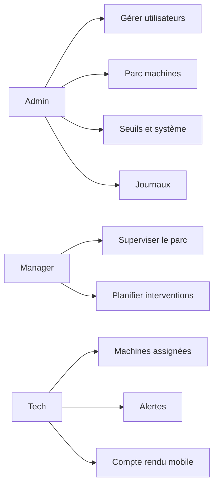

# Cas d'utilisation

| Acteur | Objectifs |
| --- | --- |
| Administrateur | Comptes, machines, appareils, seuils, audit, bootstrap initial |
| Responsable | Supervision, interventions, rapports, simulation |
| Technicien | Machines accessibles, alertes, interventions assignées, compte rendu |

Les autorisations sont appliquées **sur le serveur** (`authenticate`, `authorize`, `assertMachineAccess`).
